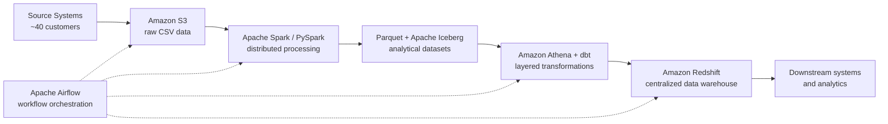

  

<h1 align="center">Hi there 👋 I'm João Victor</h1>
<h3 align="center">Building reliable data platforms, one pipeline at a time.</h3>

  
  
  
  

---

## 🌑 About Me

I'm **João Victor Poloniato Buss**, a **Data Engineer with 3+ years of experience** across software engineering, enterprise integrations, data platforms, and analytics workflows.

I specialize in **cloud-based data engineering**, with strong hands-on experience in **AWS, Apache Airflow, Databricks, Apache Spark, SQL, Python, dbt, Apache Hop, Amazon Athena, Amazon Redshift, Apache Iceberg, and Parquet**.

My focus is to build **scalable, reusable, and reliable data solutions** that reduce rework, automate workflows, and make high-quality data easier to deliver to downstream applications and analytics teams.

### 🔎 Quick Highlights

- ☁️ **Current focus:** AWS data platforms, lakehouse architectures, and analytics engineering.
- ⚙️ **What I do:** Design and orchestrate ETL/ELT pipelines, centralize integrations, and automate enterprise data flows.
- 🔄 **Orchestration:** Apache Airflow, scheduled workflows, dependency management, and reusable integration patterns.
- 📦 **Data stack:** Amazon S3, Amazon Athena, Amazon Redshift, Spark/PySpark, Databricks, Iceberg, Parquet, dbt, Apache Hop.
- 🤝 **Business mindset:** Reduce duplicated work, cut manual effort, simplify maintenance, and accelerate reliable data delivery.
- 🤖 **Also experienced in:** Backend APIs, Machine Learning, NLP, and Generative AI.
- 🎓 **Education:** B.Sc. in Information Systems (UNEMAT) + Postgraduate specialization in Data Engineering in progress.
- 🌍 **Based in:** Brazil | English: Professional Working Proficiency.

> **Engineering philosophy:** Build once, standardize well, orchestrate cleanly, and deliver trusted data at scale.

---

## 🚀 Featured Engineering Project

# Centralized AWS Data Platform for Multi-Client Integrations

One of my most relevant recent projects focused on **centralizing data integrations from multiple customers into a single AWS-based architecture**.

We had around **40 customers** using the same source system. Instead of maintaining duplicated integrations and repeated transformation logic for each one, the goal was to **standardize the flow, reduce rework, and create a scalable architecture** for reliable data delivery.

### 🧱 Architecture Overview

### 🛠️ Technologies Used

| Layer | Technologies | Purpose |
| --- | --- | --- |
| Landing & Storage | Amazon S3, CSV | Centralized ingestion and raw data storage |
| Processing | Apache Spark, PySpark | Distributed data transformation and processing |
| Lakehouse Structure | Apache Iceberg, Parquet | Standardized analytical file/table structure |
| Transformation | Amazon Athena, dbt | Layered, reusable SQL transformations |
| Serving | Amazon Redshift | Centralized warehouse for downstream consumption |
| Orchestration | Apache Airflow | Pipeline automation, scheduling, and dependency control |
| Integration Workflows | Apache Hop | Additional integration and ETL workflows |

### ✅ Business Impact

- Reduced **integration rework** by reusing common patterns across customers.
- Reduced **manual execution effort** through orchestration and automation.
- Improved **maintainability** by standardizing transformation layers and data structures.
- Accelerated **data delivery** for downstream systems and analytics use cases.
- Created a more **scalable and reliable cloud data foundation**.

> Note: I intentionally describe the solution at a high level to avoid exposing proprietary implementation details.

---

## 🛠️ Tech Stack & Tools

### ☁️ Cloud & Data Platforms

  
  
  
  
  

### 🔄 Data Engineering & Orchestration

  
  
  
  
  
  
  
  
  

### 🐍 Programming, Databases & APIs

  
  
  
  
  
  
  
  

### 🧰 DevOps, Automation & AI

  
  
  
  
  
  
  
  

---

## 💼 Professional Experience

### **Data Engineer · JMJ Sistemas e Consultoria**  
**2025 – Present**

- Designed and orchestrated **ETL/ELT workflows** using Apache Airflow, Spark, Python, and SQL.
- Contributed to a **centralized AWS-based data platform** using S3, Athena, dbt, Iceberg, Parquet, and Redshift.
- Built enterprise data integration workflows with **Apache Hop** and **n8n**.
- Developed **REST APIs and microservices** using FastAPI and Java.
- Worked on applied **Machine Learning / NLP** solutions in enterprise contexts.

### **Data Engineer · Alfameta**  
**2024 – 2025**

- Developed data pipelines with **Pentaho PDI, Apache Hop, Python, and SQL**.
- Worked with **Kafka, Spark, and Databricks** for integrations and distributed processing.
- Improved SQL transformations, data models, and integration routines.

### **Junior Software Engineer · Porto Tech**  
**2021 – 2024**

- Developed Python applications, REST APIs, and relational-database integrations.
- Worked with SQL optimization, data processing routines, and ETL/ELT support tasks.

---

## 🎓 Education & Learning

| Program | Institution | Status |
| --- | --- | --- |
| B.Sc. in Information Systems | UNEMAT | Graduated 2026 |
| Postgraduate Specialization in Data Engineering | — | In progress |

### Selected Learning
- Databricks for Data Engineering  
- AWS Machine Learning Engineer Associate preparation *(course/training)*  
- AI Engineer Core Track *(LLMs, RAG, QLoRA & Agents)*  
- Advanced SQL & Data Processing  
- Advanced Machine Learning  
- Advanced Python  

---

## 📈 GitHub Stats

  
  

  

---

## 🤝 Let's Connect

I'm always open to connecting with professionals working on:

- Cloud Data Engineering
- Workflow Orchestration
- Lakehouse & Data Platform Architecture
- Analytics Engineering
- Scalable Data Solutions
- Applied AI in data-driven environments

  📬 <strong>Email:</strong> <a href="mailto:poloniato155@gmail.com">poloniato155@gmail.com</a> 
  💼 <strong>LinkedIn:</strong> <a href="https://www.linkedin.com/in/jo%C3%A3o-victor-poloniato-buss-908177164/">João Victor Poloniato Buss</a> 
  🧑‍💻 <strong>GitHub:</strong> <a href="https://github.com/joaovictorPoloniato">@joaovictorPoloniato</a>

  <strong>Thanks for visiting — let’s build better data platforms.</strong>

  

